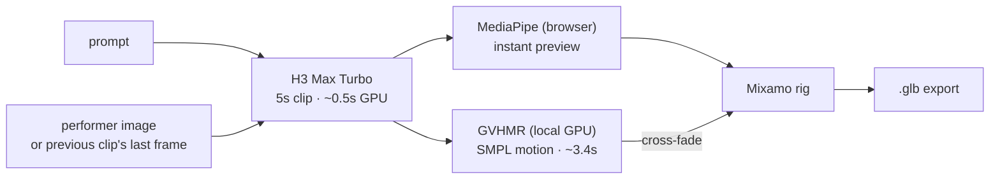
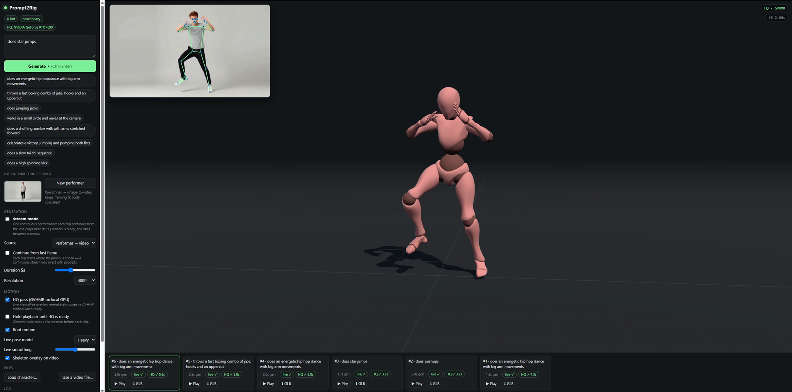

# Prompt2Rig

**Type a motion, watch a rigged character perform it — in seconds.**

A text prompt goes to a faster-than-real-time video model ([MiniMax H3 Max Turbo](https://fal.ai/models/minimax/h3-max-turbo/image-to-video) on fal), the clip's human motion is recovered with [GVHMR](https://github.com/zju3dv/GVHMR) on a local GPU, and retargeted live onto a Mixamo skeleton in the browser. Inspired by [Motion2MixamoRig](https://github.com/MaxLiu22/Motion2MixamoRig), rebuilt for interactive speed.


## How it works



| Stage | Where | Time (5s clip, RTX 4090) |
|---|---|---|
| Video generation | fal · H3 Max Turbo | ~2–3s wall (0.5s GPU) |
| **Live** preview — MediaPipe Pose, retargeted per frame | browser | immediate |
| **HQ** motion — GVHMR → SMPL rotations → Mixamo | local GPU worker | ~3.4s (0.7× real time) |

The live pass hides the wait; the HQ pass is the real result. GVHMR sees the whole clip at once, outputs joint *rotations* on a fixed-proportion body, and recovers a gravity-aware root path — so there's no jitter, limb stretching, or twisted forearms.



## Quick start

**Needs:** Node 18+, a [fal](https://fal.ai) API key. For the HQ pass: Windows + NVIDIA GPU, [`uv`](https://docs.astral.sh/uv/), `ffmpeg` on PATH.

```bash
git clone https://github.com/blendi-remade/prompt2rig && cd prompt2rig
cp .env.example .env          # add your FAL_KEY
node server.mjs               # → http://localhost:5177  (live preview works now)
```

**HQ pass (optional, recommended):**

```powershell
hq\setup.ps1                  # venv, CUDA PyTorch, GVHMR + ~5 GB checkpoints
```

Then download **SMPL-X v1.1 (NPZ)** from [smpl-x.is.tue.mpg.de](https://smpl-x.is.tue.mpg.de/) (free registration) and put `SMPLX_NEUTRAL.npz` in `hq/body_models/smplx/`. Start the worker next to the web server:

```powershell
hq\.venv\Scripts\python hq\worker.py    # → 127.0.0.1:5178, loads once and stays warm
```

## Using it

- **Generate** a prompt or click a preset. By default every clip starts from the same flux-generated *performer* (one person, full body, plain backdrop, static camera — ideal pose-estimation input).
- **Orientation** — portrait 9:16 (default) or landscape 16:9. Portrait gives the performer ~70% more pixels of height at 480P, which helps pose estimation.
- **Stream mode** — one continuous performance: each clip continues from the previous clip's last frame, plays once its HQ motion is ready while the next one generates, and short idle clips fill gaps between prompts. First motion ≈ 6s after the first prompt, continuous after that.
- **⬇ GLB** on any take exports the skinned character with the animation clip (Blender, Unity, three.js).
- **Load character…** swaps in any Mixamo-rigged `.glb`/`.fbx`; **Use a video file…** runs the live pass on your own footage.

## Project layout

| Path | |
|---|---|
| `server.mjs` | zero-dependency server; proxies fal (key stays server-side) and the HQ worker |
| `public/app.js` | UI, generation queue, live pose loop, playback & blending, stream mode, GLB export |
| `public/retarget.js` | Mixamo rig wrapper: MediaPipe landmarks → bones, SMPL rotations → bones, grounding |
| `hq/worker.py` | FastAPI worker around the `gvhmr` package, tuned for single-person generated clips |

<details>
<summary><b>HQ worker speedups</b> (stock <code>gvhmr.recover</code> 10s → 3.4s per 5s clip)</summary>

- batched single-person YOLO11m instead of frame-by-frame YOLOv8x + BoT-SORT tracking
- decoded frames reused by the crop stage (OpenCV) instead of a second PyAV decode
- ViTPose without flip-test (`HQ_POSE_FLIP=1` to re-enable — measured 0.6° mean joint difference)
- 24→30 fps resample with ffmpeg `ultrafast`; all GPU work on one warmed-up thread
- left/right keypoint-swap stabilizer from Motion2MixamoRig
- camera-relative heading so chained clips line up (seams: 1–5° hips, ≤5 cm root)

</details>

## Credits & licenses

- [GVHMR](https://github.com/zju3dv/GVHMR) (ZJU3DV) via the [`gvhmr`](https://pypi.org/project/gvhmr/) package · [Motion2MixamoRig](https://github.com/MaxLiu22/Motion2MixamoRig) (Apache-2.0) for the idea and the keypoint stabilizer
- [MediaPipe Pose](https://ai.google.dev/edge/mediapipe/solutions/vision/pose_landmarker) · [three.js](https://threejs.org) (X Bot model from its examples) · video/image models on [fal](https://fal.ai)
- **SMPL-X** is licensed for non-commercial research only and is not included — download it yourself.

Prototype — tested on Windows 11 with an RTX 4090.
