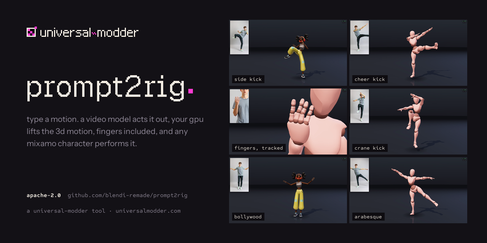
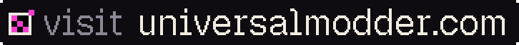
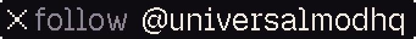
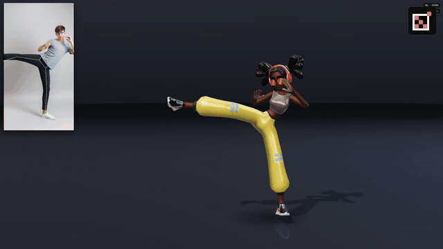
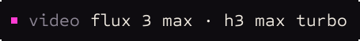
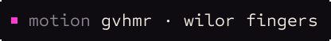
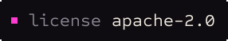
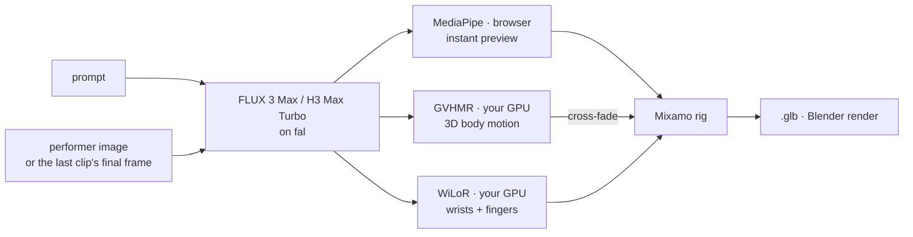
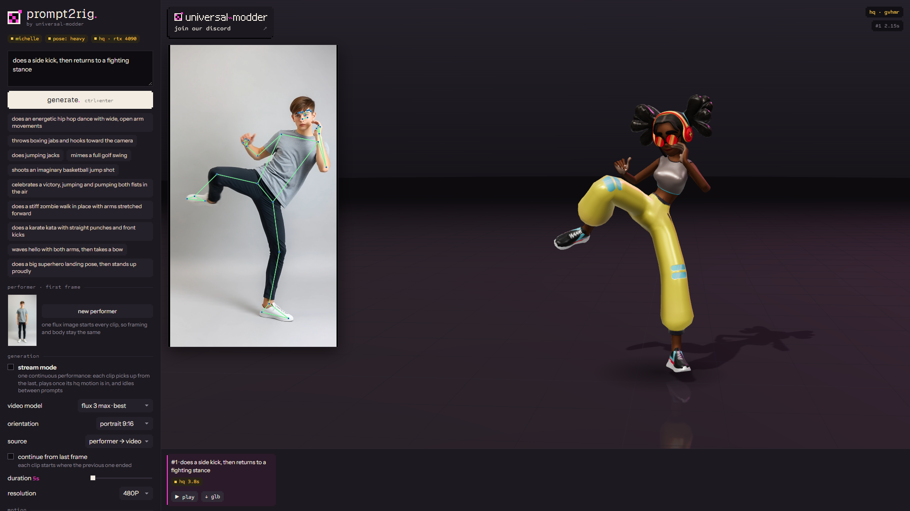

<p align="center">
  
</p>

<p align="center">
  <b>Type a motion. A video model acts it out, and any rigged character performs it, fingers included.</b><br>
  A prompt goes to a fast video model on <a href="https://fal.ai">fal</a>, your GPU recovers clean 3D body and hand motion from the clip,
  and it plays live on a Mixamo character in the browser, ready to export to Blender or Unity.
</p>

<p align="center">
  <a href="https://discord.gg/universal-modder"><picture><source media="(prefers-color-scheme: dark)" srcset="docs/media/discord-dark.svg"></picture></a>&nbsp;
  <a href="https://universalmodder.com"></a>&nbsp;
  <a href="https://x.com/universalmodhq"></a>
</p>

<p align="center">
  
</p>

<p align="center">
  <a href="#how-it-works"></a>
  <a href="#how-it-works"></a>
  <a href="#license"></a>
</p>

<p align="center">A <a href="https://universalmodder.com">universal-modder</a> tool. Share what you make, get help, and follow along on
<a href="https://discord.gg/universal-modder">discord</a> and <a href="https://x.com/universalmodhq">x</a>.</p>

## How it works



| Stage | Where | Time (5s clip, RTX 4090) |
|---|---|---|
| Video | fal · FLUX 3 Max (720p) | ~8–9s (4.5s GPU) |
| | fal · H3 Max Turbo (480P) | ~2–3s (0.5s GPU) |
| **Live** preview: MediaPipe Pose, retargeted per frame | browser | immediate |
| **HQ** motion: GVHMR → SMPL rotations → Mixamo | local GPU worker | ~3.5–4s |
| **Fingers**: WiLoR (MediaPipe fallback), in parallel with GVHMR | local GPU worker | +~0.3s |

The live pass covers the wait; the HQ pass is the result. GVHMR sees the whole clip at once, outputs joint rotations
on a fixed-proportion body and recovers a gravity-aware root path, so there's no jitter, limb stretching or twisted
forearms. WiLoR adds the palm and all 15 finger joints per hand.

<p align="center"></p>

## Quick start

**Needs:** Node 18+ and a [fal](https://fal.ai) API key. For the HQ pass: Windows, an NVIDIA GPU,
[`uv`](https://docs.astral.sh/uv/) and `ffmpeg` on PATH.

```bash
git clone https://github.com/blendi-remade/prompt2rig && cd prompt2rig
cp .env.example .env          # add your FAL_KEY
node server.mjs               # → http://localhost:5177 (the live preview works now)
```

**HQ pass (recommended):**

```powershell
hq\setup.ps1                  # venv, CUDA PyTorch, GVHMR + ~5 GB of checkpoints
```

Download **SMPL-X v1.1 (NPZ)** from [smpl-x.is.tue.mpg.de](https://smpl-x.is.tue.mpg.de/) (free registration) and put
`SMPLX_NEUTRAL.npz` in `hq/body_models/smplx/`.

**Finger tracking (optional):** WiLoR needs the MANO hand model. Register at [mano.is.tue.mpg.de](https://mano.is.tue.mpg.de),
download *Models & Code* (`mano_v1_2.zip`), then:

```powershell
hq\.venv\Scripts\python hq\setup_hands.py $HOME\Downloads\mano_v1_2.zip   # WiLoR weights + MANO
```

Without MANO, fingers fall back to MediaPipe Hands (rougher depth). Then start the worker next to the web server:

```powershell
hq\.venv\Scripts\python hq\worker.py    # → 127.0.0.1:5178, loads once and stays warm
```

## Using it

- **Generate** from a prompt or a preset. Every clip starts from the same flux-made *performer* (one person, full body,
  plain backdrop, static camera), which is the input pose estimation likes best.
- **Video model.** *FLUX 3 Max* for the most realistic motion; *H3 Max Turbo* for the fastest loop and stream mode.
- **Character.** X Bot, Michelle or Soldier (textured Mixamo rigs from the three.js examples), or **load mixamo file…**
  for any Mixamo `.fbx` / `.glb` from [mixamo.com](https://www.mixamo.com) (T-pose).
- **Track fingers.** WiLoR runs on the full-resolution clip; hands are matched to the body's wrists, rotated into the
  motion's world frame and smoothed. Untracked hands rest in a natural curl.
- **Stream mode.** One continuous performance: each clip picks up from the last one's final frame, plays once its HQ
  motion is in while the next one generates, and short idle clips fill the gaps between prompts.
- **Swap character every loop**, **cinematic camera**, portrait or landscape clips.
- **↓ glb** on any take exports the skinned character with its animation, and keeps a copy plus the source clip's URL in `takes/`.

**Prompts that retarget well** face the camera with the limbs clear of the body: dances, kicks, kata, sport mimes,
celebrations, clear hand shapes. Flips, spins, floor work and crossed or hidden arms confuse any single-camera pose
estimator; the presets and the prompt template steer away from them.

## Renders and recordings

**Blender.** Turn a saved take into a studio clip (cyclorama, three-point light, slow camera arc), headless:

```powershell
& "C:\Program Files\Blender Foundation\Blender 5.2\blender.exe" -b -P tools/render_blender.py -- takes/<take>.glb --side-by-side
```

It writes `renders/<take>.mp4` (1080×1920, or `--res 1920x1080`) and, with `--side-by-side`, the source clip next to the render.

**App recordings.** `tools/capture.mjs` drives an off-screen Chrome and records takes frame by frame at 2560×1440, so
nothing on your screen is touched:

```bash
node tools/capture.mjs --prompts tools/prompts_dynamic.txt --character xbot --out captures
node tools/capture.mjs --clip <video url> --prompt "..." --passes 2 --zoom 5.2-10.0 --zoom-bone RightHand
```

## Project layout

| Path | |
|---|---|
| `server.mjs` | zero-dependency server; proxies fal (the key stays server-side) and the HQ worker |
| `public/app.js` | UI, generation queue, live pose loop, playback and blending, stream mode, GLB export, capture hooks |
| `public/stage.js` | the stage: lighting, reflective floor, contact shadows, cinematic camera |
| `public/retarget.js` | Mixamo rig: MediaPipe landmarks → bones, SMPL rotations → bones, fingers, rig-to-rig pose copy |
| `public/brand/` | universal-modder logos and fonts (Geist Pixel, Instrument Sans, Sometype Mono, all OFL) |
| `hq/worker.py` | FastAPI worker around the `gvhmr` package, tuned for single-person generated clips |
| `hq/hands.py` | finger tracking: batched WiLoR or MediaPipe, wrist assignment, camera → world, smoothing |
| `tools/` | Blender renderer, off-screen capture, prompt lists, README media generator |
| `bench/` | hand-pose test bench: detection and jitter metrics, 2D overlays, source-vs-rig close-ups |

<details>
<summary><b>HQ worker speedups</b> (stock <code>gvhmr.recover</code>: 10s → 3.4s per 5s clip)</summary>

- batched single-person YOLO11m instead of frame-by-frame YOLOv8x + BoT-SORT tracking
- decoded frames reused by the crop stage (OpenCV) instead of a second PyAV decode
- ViTPose without flip-test (`HQ_POSE_FLIP=1` turns it back on; measured 0.6° mean joint difference)
- 24→30 fps resample with ffmpeg `ultrafast`, long side capped at 854px (GVHMR only sees 256px crops)
- fixed detector batch shape and per-orientation warm-up; all GPU work on one warmed-up thread
- WiLoR batched (2.3× faster than per-frame, same output within 0.25px) and run alongside GVHMR
- left/right keypoint-swap stabilizer from Motion2MixamoRig; camera-relative heading so chained clips line up

</details>

## Credits

- [GVHMR](https://github.com/zju3dv/GVHMR) (ZJU3DV) via the [`gvhmr`](https://pypi.org/project/gvhmr/) package ·
  [WiLoR](https://github.com/rolpotamias/WiLoR) via [WiLoR-mini](https://github.com/warmshao/WiLoR-mini) ·
  [Motion2MixamoRig](https://github.com/MaxLiu22/Motion2MixamoRig) by [@MaxLiu09](https://x.com/MaxLiu09), which started this
- [MediaPipe](https://ai.google.dev/edge/mediapipe) · [three.js](https://threejs.org) (X Bot, Michelle and Soldier from its examples) ·
  video and image models on [fal](https://fal.ai)

## Community

Made by the [universal-modder](https://universalmodder.com) crew.
[Discord](https://discord.gg/universal-modder) · [X @universalmodhq](https://x.com/universalmodhq) · [universalmodder.com](https://universalmodder.com)

## License

prompt2rig's own code is **[Apache-2.0](LICENSE)** (see [NOTICE](NOTICE)). It runs alongside third-party components
that keep their own licenses; none are included in this repo:

| Component | License | Commercial use |
|---|---|---|
| [GVHMR](https://github.com/zju3dv/GVHMR): the HQ motion pass | educational / research / non-profit only | ❌ |
| [SMPL-X](https://smpl-x.is.tue.mpg.de/) body model | non-commercial, registration required | ❌ (commercial license from Meshcapade) |
| [WiLoR](https://github.com/rolpotamias/WiLoR): finger tracking | CC-BY-NC-ND | ❌ |
| [MANO](https://mano.is.tue.mpg.de) hand model | non-commercial, registration required | ❌ |
| [Ultralytics YOLO](https://github.com/ultralytics/ultralytics): detectors in the HQ worker | AGPL-3.0 | ⚠️ copyleft, or an Ultralytics enterprise license |
| MediaPipe · three.js | Apache-2.0 · MIT | ✅ |
| Geist Pixel · Instrument Sans · Sometype Mono | SIL OFL 1.1 (bundled in `public/brand/fonts`) | ✅ |
| Mixamo characters | Adobe Mixamo terms (loaded from the three.js CDN, not redistributed) | ✅ in your own projects |
| FLUX 3 Max, H3 Max Turbo, FLUX.1 schnell | fal and model-provider terms | per those terms |

In short: the web app, the live preview and video generation are commercially usable; the **HQ path (GVHMR, SMPL-X,
WiLoR, MANO) is research / non-commercial**, so a commercial product would need to replace or license those pieces.

Tested on Windows 11 with an RTX 4090.
