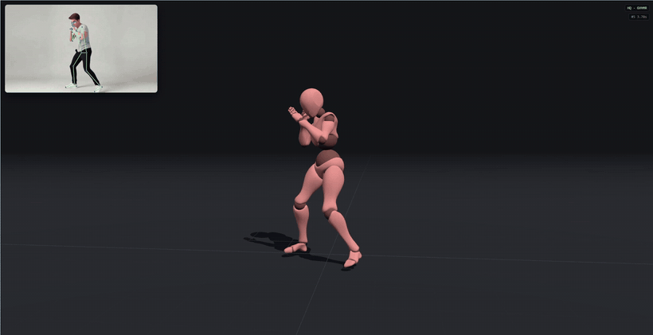
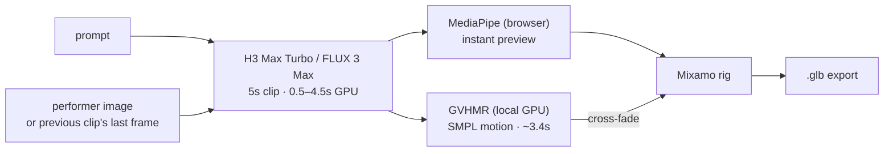
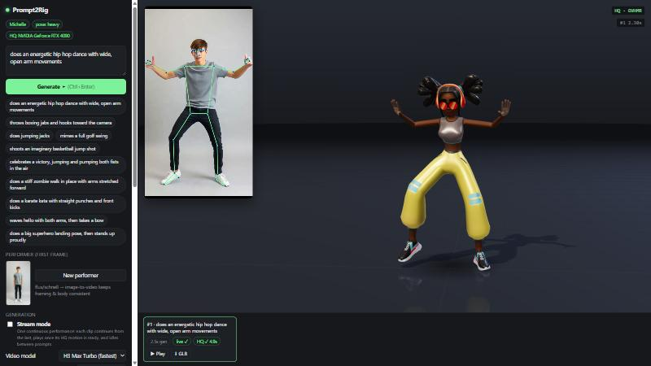

# Prompt2Rig

**Type a motion, watch a rigged character perform it — in seconds.**

A text prompt goes to a fast video model on fal — [MiniMax H3 Max Turbo](https://fal.ai/models/minimax/h3-max-turbo/image-to-video) (faster than real time) or [FLUX 3 Max](https://fal.ai/models/blackforestlabs/flux-3-max/image-to-video) (higher fidelity, ~real time) — the clip's human motion is recovered with [GVHMR](https://github.com/zju3dv/GVHMR) on a local GPU, and retargeted live onto a Mixamo skeleton in the browser. Inspired by [Motion2MixamoRig](https://github.com/MaxLiu22/Motion2MixamoRig), rebuilt for interactive speed.



## How it works



| Stage | Where | Time (5s clip, RTX 4090) |
|---|---|---|
| Video generation | fal · H3 Max Turbo (480P) | ~2–3s wall (0.5s GPU) |
| | fal · FLUX 3 Max (720p) | ~8–9s wall (4.5s GPU) |
| **Live** preview — MediaPipe Pose, retargeted per frame | browser | immediate |
| **HQ** motion — GVHMR → SMPL rotations → Mixamo | local GPU worker | ~3.5–4s (0.7–0.8× real time) |
| **Fingers** — WiLoR hand model (MediaPipe fallback), in parallel with GVHMR | local GPU worker | +~0.3s |

The live pass hides the wait; the HQ pass is the real result. GVHMR sees the whole clip at once, outputs joint *rotations* on a fixed-proportion body, and recovers a gravity-aware root path — so there's no jitter, limb stretching, or twisted forearms.



## Quick start

**Needs:** Node 18+, a [fal](https://fal.ai) API key. For the HQ pass: Windows + NVIDIA GPU, [`uv`](https://docs.astral.sh/uv/), `ffmpeg` on PATH.

```bash
git clone https://github.com/blendi-remade/prompt2rig && cd prompt2rig
cp .env.example .env          # add your FAL_KEY
node server.mjs               # → http://localhost:5177  (live preview works now)
```

**HQ pass (optional, recommended):**

```powershell
hq\setup.ps1                  # venv, CUDA PyTorch, GVHMR + ~5 GB checkpoints
```

Then download **SMPL-X v1.1 (NPZ)** from [smpl-x.is.tue.mpg.de](https://smpl-x.is.tue.mpg.de/) (free registration) and put `SMPLX_NEUTRAL.npz` in `hq/body_models/smplx/`.

**Finger tracking (optional):** WiLoR needs the MANO hand model — register at [mano.is.tue.mpg.de](https://mano.is.tue.mpg.de) and download *Models & Code* (`mano_v1_2.zip`), then:

```powershell
hq\.venv\Scripts\python hq\setup_hands.py $HOME\Downloads\mano_v1_2.zip   # WiLoR weights + MANO (converted for modern Python)
```

Without MANO, fingers fall back to MediaPipe Hands (less accurate depth). Start the worker next to the web server:

```powershell
hq\.venv\Scripts\python hq\worker.py    # → 127.0.0.1:5178, loads once and stays warm
```

## Using it

- **Generate** a prompt or click a preset. By default every clip starts from the same flux-generated *performer* (one person, full body, plain backdrop, static camera — ideal pose-estimation input).
- **Video model** — *H3 Max Turbo* for the snappiest loop and Stream mode; *FLUX 3 Max* for more realistic motion (best for single takes — at ~9s per 5s clip it can't keep a chained stream fed yet).
- **Character** — X Bot, Michelle or Soldier (textured Mixamo rigs from the three.js examples), or **Load Mixamo file…** for any Mixamo `.fbx`/`.glb` (download from [mixamo.com](https://www.mixamo.com), T-pose).
- **Track fingers** — the HQ pass also recovers hands: WiLoR (MANO-based) on the full-resolution clip, assigned to the body's wrists, rotated into the motion's world frame and smoothed; the rig gets palm orientation plus all 15 finger joints. Untracked hands rest in a natural curl.
- **Swap character every loop** — X Bot → Michelle → Soldier, cutting on each loop (or each new clip in Stream mode). The motion lives on one hidden driver rig; the character on stage copies its pose, so swapping is instant.
- **Cinematic camera** — slow arc and push-in around the performer on a studio stage (environment lighting, warm key + cool rim, soft reflective floor, contact shadows). Drag to take over; it resumes after a few seconds.
- **Orientation** — portrait 9:16 (default) or landscape 16:9. Portrait gives the performer ~70% more pixels of height at 480P, which helps pose estimation.
- **Stream mode** — one continuous performance: each clip continues from the previous clip's last frame, plays once its HQ motion is ready while the next one generates, and short idle clips fill gaps between prompts. First motion ≈ 6s after the first prompt, continuous after that.
- **⬇ GLB** on any take exports the skinned character with the animation clip (Blender, Unity, three.js), and keeps a copy plus the source-clip URL in `takes/`.
- **Prompts that retarget well** face the camera with limbs clear of the body — dance, boxing, golf/basketball mimes, celebrations, kata. Flips, spins, floor work and crossed or hidden arms confuse any monocular pose estimator. The presets and the prompt template steer toward this.
- **Use a video file…** runs the live pass on your own footage.

## Blender renders

Turn any saved take into a polished clip — studio cyclorama, three-point lighting, slow camera arc — headlessly:

```powershell
& "C:\Program Files\Blender Foundation\Blender 5.2lender.exe" -b -P tools/render_blender.py -- takes/<take>.glb --side-by-side
```

Writes `renders/<take>.mp4` (1080×1920 by default, `--res 1920x1080` for landscape) and, with `--side-by-side`, `renders/<take>_compare.mp4` with the generated source clip next to the render. Pass several `.glb` files to place characters side by side; `--preview` renders a quick low-res draft.

## Project layout

| Path | |
|---|---|
| `server.mjs` | zero-dependency server; proxies fal (key stays server-side) and the HQ worker |
| `public/app.js` | UI, generation queue, live pose loop, playback & blending, stream mode, GLB export |
| `public/stage.js` | studio stage: lighting, reflective floor, contact shadows, cinematic camera |
| `public/retarget.js` | Mixamo rig wrapper: MediaPipe landmarks → bones, SMPL rotations → bones, rig-to-rig pose copy, grounding |
| `hq/hands.py` | finger tracking: WiLoR (batched) / MediaPipe backends, wrist assignment, camera→world, smoothing |
| `tools/render_blender.py` | headless Blender (5.x) renderer for exported takes |
| `bench/` | hand-pose test bench: detection/jitter metrics, 2D overlays, source-vs-rig close-up reviews |
| `hq/worker.py` | FastAPI worker around the `gvhmr` package, tuned for single-person generated clips |

<details>
<summary><b>HQ worker speedups</b> (stock <code>gvhmr.recover</code> 10s → 3.4s per 5s clip)</summary>

- batched single-person YOLO11m instead of frame-by-frame YOLOv8x + BoT-SORT tracking
- decoded frames reused by the crop stage (OpenCV) instead of a second PyAV decode
- ViTPose without flip-test (`HQ_POSE_FLIP=1` to re-enable — measured 0.6° mean joint difference)
- 24→30 fps resample with ffmpeg `ultrafast`, long side capped at 854px (GVHMR only sees 256px crops)
- fixed detector batch shape and per-orientation warm-up; all GPU work on one warmed-up thread
- left/right keypoint-swap stabilizer from Motion2MixamoRig
- camera-relative heading so chained clips line up (seams: 1–5° hips, ≤5 cm root)

</details>

## Credits

- [GVHMR](https://github.com/zju3dv/GVHMR) (ZJU3DV) via the [`gvhmr`](https://pypi.org/project/gvhmr/) package · [Motion2MixamoRig](https://github.com/MaxLiu22/Motion2MixamoRig) for the idea, the keypoint stabilizer and the SMPL joint helper
- [MediaPipe Pose](https://ai.google.dev/edge/mediapipe/solutions/vision/pose_landmarker) · [three.js](https://threejs.org) (X Bot, Michelle and Soldier from its examples) · video and image models on [fal](https://fal.ai)

## License

Prompt2Rig's own code is licensed under **[Apache-2.0](LICENSE)** (see [NOTICE](NOTICE)).

It runs alongside third-party components that keep their own licenses — none are included in this repo:

| Component | License | Commercial use |
|---|---|---|
| [GVHMR](https://github.com/zju3dv/GVHMR) — the HQ motion pass | educational / research / non-profit only | ❌ |
| [SMPL-X](https://smpl-x.is.tue.mpg.de/) body model | non-commercial, registration required | ❌ (separate commercial license from Meshcapade) |
| [WiLoR](https://github.com/rolpotamias/WiLoR) — finger tracking | CC-BY-NC-ND | ❌ |
| [MANO](https://mano.is.tue.mpg.de) hand model | non-commercial, registration required | ❌ |
| [Ultralytics YOLO](https://github.com/ultralytics/ultralytics) — person detector in the HQ worker | AGPL-3.0 | ⚠️ copyleft, or an Ultralytics enterprise license |
| MediaPipe · three.js | Apache-2.0 · MIT | ✅ |
| Mixamo characters | Adobe Mixamo terms (loaded from the three.js CDN, not redistributed) | ✅ in your own projects |
| H3 Max Turbo, FLUX 3 Max, FLUX.1 schnell | fal and model-provider terms | per those terms |

In short: the web app, live preview and video generation are commercially usable; the **HQ path (GVHMR + SMPL-X) is research / non-commercial**, so a commercial product would need to replace or license those pieces.

Prototype — tested on Windows 11 with an RTX 4090.
